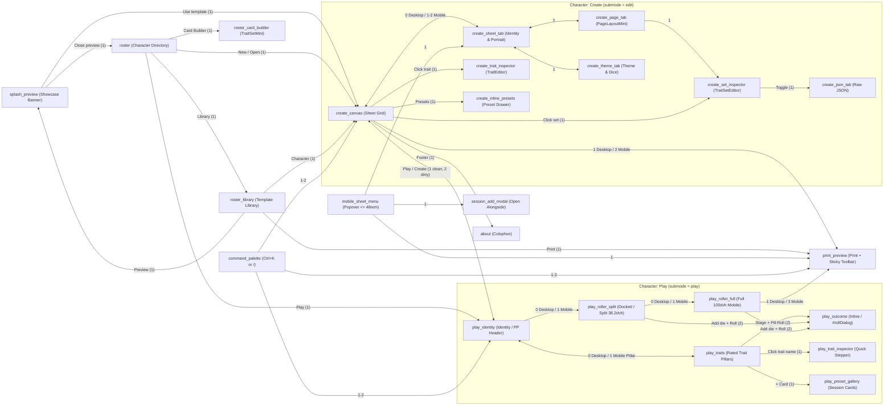

# Feature State Graph & User Interaction Map — Character Curio

> Companion to [COMPONENT_CENSUS.md](file:///c:/Users/lynnj/source/repos/lynn0702/KaelriFork/cortex-toolkit/design/COMPONENT_CENSUS.md) (`43` surfaces across `39` Vue SFCs), backed by the executable solver and Playwright journey counter in [interaction-map.cjs](file:///c:/Users/lynnj/source/repos/lynn0702/KaelriFork/cortex-toolkit/scripts/interaction-map.cjs).
>
> **Provenance Key (`provenance-labels`):** Every architectural baseline, scoring model, friction finding, and candidate improvement is tagged `[DECIDED]` (ratified in [DECISIONS.md](file:///c:/Users/lynnj/source/repos/lynn0702/KaelriFork/cortex-toolkit/design/DECISIONS.md) or [COMPONENT_CENSUS.md](file:///c:/Users/lynnj/source/repos/lynn0702/KaelriFork/cortex-toolkit/design/COMPONENT_CENSUS.md)), `[SUGGESTION]` (proposed metric, budget, or UX refinement), or `[OPEN]` (trade-off requiring author decision).
>
> **Verdict Separation (`mobile-verdict-separation`):**
> - **Static Graph Tier:** Exact Dijkstra shortest-path hop/cost calculations across `24` canonical state nodes and `282` directed edges.
> - **Runtime Telemetry Tier:** Empirical Playwright execution (`npm run interaction-map:live`) in headless Chromium at Desktop (`1440×900`) and Mobile (`390×844`) verifying real DOM click/keypress counts, viewport reachability, scroll travel (`px`), `0` JS/console errors, and `0` remote base-font requests.
> - **Visual Verdict Tier:** Neither tier above substitutes for human visual inspection of typography, alignment, or aesthetics (`npm run smoke -- --shots`).

---

## 1. State-Space Coordinate Model

### 1.1 How App Locations Map to Reactive State

- `[DECIDED]` Character Curio is a single-page Vue 3 state machine rooted in [app.vue](file:///c:/Users/lynnj/source/repos/lynn0702/KaelriFork/cortex-toolkit/js/app.vue#L38-L49). Every reachable UI location corresponds to a discrete tuple:
  `(mode, submode, editing, studioPanelTab, panelState, activeOverlay)`
  - `mode`: `'roster' | 'character' | 'about'` (plus `isPreview === true` for first-visit Showcase Preview).
  - `submode` (when `mode === 'character'`): `'edit' | 'play' | 'print'`.
  - `editing`: `[]` (sheet root), `['name'] | ['page'] | ['theme'] | ['dice']` (sheet root sub-tabs), `['traitSet', s]`, `['trait', s, t]`, `['subtrait', s, t, u]`, or `['scaleDie', s]`.
  - `studioPanelTab`: `'properties' | 'roller' | 'json'`.
  - `panelState`: `isStudioPanelOpen` (`boolean` on Desktop; defaults `true` at `>= 87.5rem` / `1400px` and `false` below `1400px` per `isNarrowViewport()` in [app.vue](file:///c:/Users/lynnj/source/repos/lynn0702/KaelriFork/cortex-toolkit/js/app.vue#L398-L415)) paired with `mobileDrawerState` (`'staged' | 'split' | 'full'` in Mobile Play per [COMPONENT_CENSUS.md](file:///c:/Users/lynnj/source/repos/lynn0702/KaelriFork/cortex-toolkit/design/COMPONENT_CENSUS.md#L34-L37)).
  - `activeOverlay`: `null`, `#mobile-sheet-menu` (`[popover="auto"]`), `dialog.modal-library`, `dialog.modal-command-palette`, `dialog.modal-session-add`, `dialog.modal-style-gallery`, `dialog.trait-set-mini-dialog`, `dialog#rollDialog`, or `dialog.modal-confirm`.

### 1.2 Interaction Cost Accounting Rules (`[SUGGESTION]`)

- `[SUGGESTION]` **Unit of interaction (`cost = 1`):** One discrete user intent gesture — a pointer `click`, touch `tap`, horizontal pillar `swipe`, or single keyboard shortcut chord (`/` or `Ctrl+K`, `Escape`, `Ctrl+Z`).
- `[SUGGESTION]` **Zero-cost co-visibility (`cost = 0`):** On wide Desktop (`>= 1400px`), `<StudioPanel>` (`23rem`) docks beside `.sheet-column` without occluding it ([studio-panel.css](file:///c:/Users/lynnj/source/repos/lynn0702/KaelriFork/cortex-toolkit/css/studio-panel.css#L71-L83)). Transitioning focus between the visible sheet canvas and the open docked panel costs `0` navigation clicks, whereas on Mobile (`<= 48rem`) full-width `.studio-panel` overlays require an explicit open/collapse tap (`cost = 1`).
- `[SUGGESTION]` **Three Input Profiles:**
  1. **Desktop Pointer (`1440×900`):** Mouse/trackpad clicks with docked `<StudioPanel>` and sticky `<SessionNav>`.
  2. **Desktop Keyboard + Pointer (`1440×900`):** Adds `/` / `Ctrl+K` `<CommandPalette>`, `Escape` deselect, and `Ctrl+Z` / `Ctrl+Y`.
  3. **Mobile Touch (`390×844`):** Single `3rem` `<AppHeader>` with `#mobile-sheet-menu` popover, 2D Pillar Deck (`.mobile-set-jump-strip` + `.mobile-pillar-track`), and 3-state Play drawer (`staged` pill bar → `split` `38.2dvh` → `full` `100dvh`).

---

## 2. Feature Graph Topology



---

## 3. Canonical Node Catalog (`24` Locations Covering All `43` Census Surfaces)

Every node below is registered in [interaction-map.cjs](file:///c:/Users/lynnj/source/repos/lynn0702/KaelriFork/cortex-toolkit/scripts/interaction-map.cjs#L22-L195) and cross-referenced by surface number to [COMPONENT_CENSUS.md](file:///c:/Users/lynnj/source/repos/lynn0702/KaelriFork/cortex-toolkit/design/COMPONENT_CENSUS.md#L55-L100):

| Node ID | Location Name | Reactive State Signature | Census `#` | Verified Entry Selector |
| --- | --- | --- | --- | --- |
| `splash_preview` | Showcase Preview | `mode='character', isPreview=true` | `#1, #43` | `.template-preview-banner` |
| `roster` | Roster Directory | `mode='roster'` | `#2, #5, #13, #41` | `section.roster` |
| `roster_library` | Template Library Modal | `mode='roster', showLibrary=true` | `#9, #22, #30, #42` | `dialog.modal-library` |
| `roster_card_builder` | Card Builder (`TraitSetMini`) | `showTraitSetMini=true` | `#37` | `dialog.trait-set-mini-dialog` |
| `create_canvas` | Create Sheet Canvas | `submode='edit', editing=[]` | `#1–4, #8–9, #13, #16–22` | `.character-sheet.submode-edit` |
| `create_sheet_tab` | Sheet Identity & Portrait Tab | `submode='edit', sheetTab='sheet'` | `#6, #23, #31, #38` | `#studio-tab-sheet[aria-selected="true"]` |
| `create_page_tab` | Page Band & Column Map | `submode='edit', sheetTab='page'` | `#6, #23, #28` | `#studio-tab-page[aria-selected="true"]` |
| `create_theme_tab` | Theme & Dice Style Tab | `submode='edit', sheetTab='theme'` | `#6, #23, #31` | `#studio-tab-theme[aria-selected="true"]` |
| `create_set_inspector` | Trait Set Inspector | `submode='edit', editing=['traitSet', s]` | `#6, #12, #25–27, #32, #38, #42` | `.studio-panel input[name="traitSetName"]` |
| `create_trait_inspector` | Trait / Subtrait / SFX Inspector | `submode='edit', editing=['trait', s, t]` | `#6, #11, #38` | `.studio-panel aside.editor.open .editor-copy` |
| `create_json_tab` | Raw JSON Inspector | `submode='edit', panelTab='json'` | `#6, #34` | `.studio-panel .json-editor` |
| `create_inline_presets` | Inline Add-Set Preset Drawer | `submode='edit', showInlineAddSet=true` | `#35` | `.inline-add-set-area` |
| `play_identity` | Play Sheet — Identity / PP Band | `submode='play', pillar='identity'` | `#1, #2, #8, #13–16, #24` | `.character-sheet.submode-play` |
| `play_traits` | Play Sheet — Rated Trait Pillars | `submode='play', pillar='prime\|plus\|play'` | `#1, #3–4, #9, #14–15, #17–22` | `.character-sheet.submode-play [aria-label^="Stage d"]` |
| `play_roller_split` | Play Roller (`Docked` / `Split`) | `submode='play', panelTab='roller', split` | `#6, #7, #40` | `.dice-roller-sidebar` |
| `play_roller_full` | Play Roller (`Docked` / `Full 100dvh`) | `submode='play', panelTab='roller', full` | `#6, #7, #40` | `.roller-roll-btn` |
| `play_outcome` | Roll Outcome Breakdown / Dialog | `submode='play', isRolled=true` | `#10` | `.outcome-shell, dialog#rollDialog[open]` |
| `play_trait_inspector` | Play Trait Quick-Stepper | `submode='play', editing=['trait', s, t]` | `#6, #11` | `.studio-panel.is-play aside.editor.open` |
| `play_preset_gallery` | Play Session Card Gallery Modal | `submode='play', showPlayPresetPicker=true` | `#35, #42` | `dialog.modal-style-gallery` |
| `mobile_sheet_menu` | Mobile Header Sheet Menu | `#mobile-sheet-menu:popover-open` | `#13, #39` | `#mobile-sheet-menu` |
| `session_add_modal` | Open Sheet Alongside Modal | `isAddCharacterModalOpen=true` | `#36, #42` | `dialog.modal-session-add` |
| `command_palette` | Command Palette (`Ctrl+K` / `/`) | `isPaletteOpen=true` | `#33, #42` | `dialog.modal-command-palette` |
| `print_preview` | Print Preview & Sticky Toolbar | `mode='character', submode='print'` | `#1, #29` | `.character-sheet.submode-print` |
| `about` | About & Legal Colophon | `mode='about'` | `#41, #43` | `article.about` |

---

## 4. All-Pairs Hub Shortest-Path Matrix (`Desktop Pointer / Mobile Touch`)

Cells show **`Desktop Pointer / Mobile Touch`** minimum interaction counts computed by `npm run interaction-map` (clean session baseline):

| From \ To | `Roster` | `Library` | `Create` | `Theme` | `SetEd` | `TraitEd` | `PlayId` | `PlayTr` | `Roller` | `Print` | `About` |
| --- | :---: | :---: | :---: | :---: | :---: | :---: | :---: | :---: | :---: | :---: | :---: |
| **`Roster`** (`roster`) | — | `1 / 1` | `1 / 1` | `2 / 3` | `2 / 2` | `2 / 2` | `1 / 1` | `1 / 2` | `1 / 3` | `2 / 2` | `1 / 1` |
| **`Library`** (`roster_library`) | `1 / 1` | — | `1 / 1` | `2 / 3` | `2 / 2` | `2 / 2` | `2 / 2` | `2 / 3` | `2 / 4` | `1 / 1` | `2 / 2` |
| **`Create`** (`create_canvas`) | `1 / 1` | `2 / 2` | — | `1 / 2` | `1 / 1` | `1 / 1` | `1 / 1` | `1 / 2` | `1 / 3` | `1 / 2` | `1 / 1` |
| **`Theme`** (`create_theme_tab`) | `1 / 1` | `2 / 2` | `0 / 1` | — | `1 / 2` | `1 / 2` | `1 / 1` | `1 / 2` | `1 / 3` | `1 / 2` | `1 / 2` |
| **`SetEd`** (`create_set_inspector`) | `1 / 1` | `2 / 2` | `0 / 1` | `1 / 2` | — | `1 / 2` | `1 / 1` | `1 / 2` | `1 / 3` | `1 / 2` | `1 / 2` |
| **`TraitEd`** (`create_trait_inspector`) | `1 / 1` | `2 / 2` | `0 / 1` | `1 / 2` | `1 / 1` | — | `1 / 1` | `1 / 2` | `1 / 3` | `1 / 2` | `1 / 2` |
| **`PlayId`** (`play_identity`) | `1 / 1` | `2 / 2` | `1 / 1` | `2 / 3` | `2 / 2` | `2 / 2` | — | `0 / 1` | `0 / 2` | `1 / 2` | `1 / 2` |
| **`PlayTr`** (`play_traits`) | `1 / 1` | `2 / 2` | `1 / 1` | `2 / 3` | `2 / 2` | `2 / 2` | `0 / 1` | — | `0 / 2` | `1 / 2` | `1 / 2` |
| **`Roller`** (`play_roller_full`) | `1 / 2` | `2 / 3` | `1 / 2` | `2 / 4` | `2 / 3` | `2 / 3` | `0 / 2` | `0 / 1` | — | `1 / 3` | `1 / 3` |
| **`Print`** (`print_preview`) | `1 / 1` | `2 / 2` | `1 / 1` | `2 / 3` | `2 / 2` | `2 / 2` | `1 / 1` | `1 / 2` | `1 / 3` | — | `1 / 1` |
| **`About`** (`about`) | `1 / 1` | `2 / 2` | `2 / 2` | `3 / 4` | `3 / 3` | `3 / 3` | `2 / 2` | `2 / 3` | `2 / 4` | `2 / 2` | — |

> [!TIP]
> Query any exact pair's step-by-step selector chain from the terminal:
> `node scripts/interaction-map.cjs --from play_roller_full --to print_preview`

---

## 5. Task Journeys — Static Graph vs. Live Chromium Telemetry

### 5.1 Static Task Matrix (`17` Core User Tasks)

| ID | User Goal (`Start -> Target + Terminal Action`) | Desktop Pointer | Desktop Key+Ptr | Mobile Touch | Mobile `Δ` |
| --- | --- | :---: | :---: | :---: | :---: |
| `T01` | Materialize showcase preview into an editable sheet (`splash_preview -> create_canvas`) | `1` | `1` | `1` | `0` |
| `T02` | Create character from Template Library (`roster -> roster_library + "+ Character"`) | `2` | `2` | `2` | `0` |
| `T03` | Change sheet Theme or Dice preset (`create_canvas -> create_theme_tab + pick`) | `2` | `2` | `3–4`* | `+1` to `+2` |
| `T04` | Switch from inspecting Set A to Set B (`create_set_inspector -> create_canvas + click Set B`) | `1` | `1` | `2` | `+1` |
| `T05` | Change a Trait Set's border from Play and return (`play_traits -> create_set_inspector -> play`) | `4` | `4` | `4` | `0` |
| `T06` | Open Raw JSON from Set Inspector and return to sheet (`create_set_inspector -> create_json_tab -> sheet`) | `2` | `2` | `2` | `0` |
| `T07` | Enter Play from Create, stage a rated trait die, and roll (`create_canvas -> play_outcome`) | `3` | `3` | `3–4`† | `0` to `+1` |
| `T08` | Quick-add a raw `d8` in Roller and roll (`play_identity -> play_roller_split + d8 + Roll`) | `2` | `2` | `3` | `+1` |
| `T09` | Step Plot Points (`+1 PP`) on arrival in Play (`play_identity`) | `1` | `1` | `1` | `0` |
| `T10` | Leave dirty Play session back to Create (`play_identity -> Save confirm -> create_canvas`) | `2` | `2` | `2` | `0` |
| `T11` | From Full `100dvh` Roller, open Print Preview & trigger Print (`play_roller_full -> print_preview + Print`) | `2` | `2` | `4` | **`+2`** |
| `T12` | Export character JSON from Play mode (`play_traits -> print_preview + Export JSON`) | `2` | `2` | `3` | `+1` |
| `T13` | Open a second sheet alongside active Play sheet (`play_traits -> session_add_modal + pick`) | `2` | `2` | `3` | `+1` |
| `T14` | Jump from Print Preview directly to editing a Trait (`print_preview -> create_trait_inspector`) | `2` | `2`‡ | `2` | `0` |
| `T15` | Add a temporary Play session card (`play_traits -> play_preset_gallery + Add to Session`) | `2` | `2` | `2` | `0` |
| `T16` | Open About / Legal colophon from Play (`play_traits -> about`) | `1` | `1` | `2` | `+1` |
| `T17` | Launch an existing character directly into Play from Roster (`roster -> play_identity`) | `1` | `1` | `1` | `0` |

*\* `T03` on Mobile costs `3` taps when at the top of the sheet (`.sheet-header-meta-box` → `#studio-tab-theme` → swatch) or `4` taps from anywhere via `#mobile-sheet-menu` (`.mobile-sheet-trigger` → `Sheet Settings` → `#studio-tab-theme` → swatch).*
*† `T07` on Mobile costs `3` taps when rated sets are in column `0` (no `identity` Name set, e.g., `Dreamer_Architect`), or `4` taps on multi-pillar sheets where `identity` occupies column `0` (`+1` tap on `.jump-pill` or horizontal swipe).*
*‡ `T14` via keyboard (`/` → filter trait → `Enter` = `3` keystrokes) avoids pointer scrolling when the target trait sits below the fold or on Page 2.*

### 5.2 Empirical Playwright Journey Telemetry (`npm run interaction-map:live`)

Measured live in headless Chromium across `13` sequential end-to-end journeys (`0` mismatches between `Observed` and `Static` model; `0` console/page errors; `0` remote font requests):

| Live ID | Executed Browser Journey | Desktop `1440×900` Steps (`Static`) | Desktop Scroll | Mobile `390×844` Steps (`Static`) | Mobile Scroll | Key Mechanism Verified |
| --- | --- | :---: | :---: | :---: | :---: | --- |
| `J01` | Splash Preview → Materialize Editable Sheet | `1 (1)` | `0px` | `1 (1)` | `0px` | `.btn-update-primary` materializes layered showcase directly into `submode-edit`. |
| `J02` | Create Canvas → Sheet Theme & Dice Tab | `1 (1)` | `0px` | `3 (3)` | `0px` | Desktop `StudioPanel` starts docked open; Mobile starts closed (`#mobile-sheet-menu` → `Sheet Settings` → `Theme`). |
| `J03` | Create Canvas → Inspect Set A → Inspect Set B | `2 (2)` | `0px` | `3 (3)` | `0px` | Mobile full-width `.studio-panel` requires `+1` tap on `Collapse panel` to uncover canvas between set selections. |
| `J04` | Set Inspector → Raw JSON → Uncovered Sheet | `2 (2)` | `0px` | `2 (2)` | `0px` | `button[aria-label="Raw JSON Editor"]` toggles inline on Desktop; `Collapse panel` exits directly on Mobile. |
| `J05` | Create → Play → Stage Sheet Trait Die → Roll (Single-Col) | `3 (3)` | `0px` | `3 (3)` | `0px` | `.mobile-roller-pill-bar` exposes `.btn-pill-roll` as soon as `1` die is staged — **zero drawer expansion needed**! |
| `J06` | Play Sheet → Quick-Add Raw `d8` → Roll | `2 (2)` | `0px` | `3 (3)` | `0px` | Mobile `split` (`38.2dvh`) keeps `Player/Opposition` tabs, `PP`, `Quick Add`, and `44px` `.roller-roll-btn` co-visible (`0px` scroll). |
| `J07` | Active Split/Docked Roller → Print Preview | `1 (1)` | `0px` | `2 (2)` | `0px` | Staying in `split` (`38.2dvh`) keeps `.header` unobstructed (`#mobile-sheet-menu` → `Print` in `2` taps). |
| `J08` | Print → Roster → Template Library → Preview | `3 (3)` | `0px` | `3 (3)` | `0px` | Symmetric modal + header flow across viewports. |
| `J09` | Play (`+1 PP` Dirty) → Save Gate → Create | `3 (3)` | `0px` | `3 (3)` | `0px` | Uncommitted Play mutations trigger `dialog.modal-confirm` (`+1` explicit Save/Discard click on mode exit). |
| `J10` | Create → Command Palette → Play Mode | `2 (2)` | `0px` | `2 (2)` | `0px` | `/` shortcut on Desktop and `.header-btn-search` on Mobile both jump modes in `2` interactions. |
| `J11` | Multi-Pillar Play (`Identity` Col 0) → Stage Die → Roll | `2 (2)` | `0px` | `3 (3)` | `355px` | `identity` occupies column `0` (`355px` horizontal scroll to `plus`/`prime` column via `.jump-pill` before staging). |
| `J12` | Play Sheet → Add Play Session Card | `2 (2)` | `0px` | `2 (2)` | `232px` | `.session-nav .sheet-bar-add-card` (`+ Card`) on Desktop and `.jump-pill-add-card` on Mobile achieve `2 / 2` parity. |
| `J13` | Roster → Direct Play Mode | `1 (1)` | `0px` | `1 (1)` | `0px` | `.roster-button-play` (`Play`) jumps straight from `Roster` into `submode-play` in `1` click/tap. |

---

## 6. Key Findings, Shipped Reductions, & Remaining Candidates

1. **Staged Pill Bar Eliminates Mobile Roller Tax for Sheet-Driven Rolls (`[DECIDED]` strength verified)**
   - When rolling dice directly from character traits (`J05`), Mobile Touch matches Desktop Pointer click-for-click (`3` vs `3` on single-pillar sheets; `3` vs `2` once in Play on multi-pillar sheets) because `.mobile-roller-pill-bar` surfaces `.btn-pill-roll` inline without opening the drawer.

2. **Direct `Play` Action on Roster Cards (`T17` / `J13`, `-1` Interaction Across Every `Roster → Play` Path) `[SUGGESTION]` — Implemented**
   - Non-template character cards in [roster.vue](file:///c:/Users/lynnj/source/repos/lynn0702/KaelriFork/cortex-toolkit/js/roster.vue#L788-L796) now expose a primary `Play` action (`.roster-button-play`) wired to `loadCharacter(id, 'play')` in [app.vue](file:///c:/Users/lynnj/source/repos/lynn0702/KaelriFork/cortex-toolkit/js/app.vue#L1197-L1208), cutting `Roster → Play` from `2` clicks/taps to **`1` click/tap** (`1 / 1` to `play_identity`, `1 / 2` to `play_traits`, `1 / 3` to `play_roller_full`).

3. **Mobile `split` (`38.2dvh`) Roller Co-Visibility & `44px` Touch CTA (`T08` / `J06` / `J07`, `-1` Tap on Roll & `-1` Tap on Exit) `[SUGGESTION]` — Implemented**
   - Unhiding `.roller-top-bar` (`Player | Opposition` pool switcher + `PP` stepper) inside `.studio-panel.is-play[data-state='split']` and sizing `.roller-roll-btn` to `min-block-size: 2.75rem` (`44px`) in [roller.css](file:///c:/Users/lynnj/source/repos/lynn0702/KaelriFork/cortex-toolkit/css/roller.css#L1006-L1010) lets players quick-add dice, switch to `Opposition`, adjust `PP`, and roll directly from `split` in **`3` taps (`0px` scroll)** while keeping `.header` unobstructed (`J07`: `2` taps to `Print` instead of `3`).

4. **Desktop `<SessionNav>` `+ Card` Trigger (`T15` / `J12`, `3 → 2` Clicks & Zero Hidden Precondition) `[SUGGESTION]` — Implemented**
   - `<SessionNav>` ([session-nav.vue](file:///c:/Users/lynnj/source/repos/lynn0702/KaelriFork/cortex-toolkit/js/session-nav.vue#L127-L137)) now exposes `.sheet-bar-add-card` (`+ Card`) in `submode === 'play'`, opening `openPlayPresetPicker()` on the focused `<Character>` in both single-sheet and side-by-side multi-character Desktop Play (`2` clicks Desktop / `2` taps Mobile).

5. **Character JSON Export from Play/Create Requires Routing Through `Print` or `Roster` (`T12`) `[OPEN]`**
   - Exporting a single character's `.json` from active `Play` or `Create` requires switching to `Print` (`.print-toolbar` → `Export JSON`: `2` clicks Desktop / `3` taps Mobile) or `Roster` (`.roster-button-export`).
   - `[OPEN]` Should `<CommandPalette>` include an `Export Character JSON` action (`action-export`) and/or `#mobile-sheet-menu` include `Export` alongside `Print`?

6. **Mobile Play Occludes `<AppFooter>` (`About` Unreachable Directly from Play, `T16`) `[SUGGESTION]`**
   - Consistent with Macro Finding `#3` in [COMPONENT_CENSUS.md](file:///c:/Users/lynnj/source/repos/lynn0702/KaelriFork/cortex-toolkit/design/COMPONENT_CENSUS.md#L45), `.mobile-roller-pill-bar` (`z-index: 950`) covers `footer.footer` (`z-index: 900`) across Mobile Play, requiring users to exit Play to `Roster` or `Create` (`2` taps) to reach `About`.

---

## 7. Running & Extending the Map

- **Static matrices & hotspot report (`< 100ms`):**
  ```sh
  npm run interaction-map
  ```
- **Query shortest path & exact selectors between any two locations:**
  ```sh
  node scripts/interaction-map.cjs --from create_trait_inspector --to play_outcome
  ```
- **Live Playwright verification across Desktop (`1440×900`) & Mobile (`390×844`):**
  ```sh
  npm run interaction-map:live
  ```
- **Machine-readable JSON export (for CI diffs or dashboards):**
  ```sh
  node scripts/interaction-map.cjs --live --json
  ```
